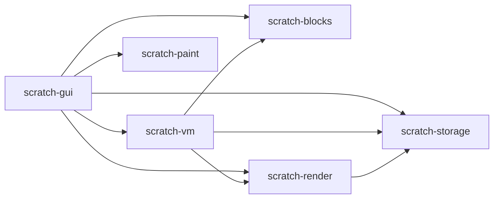

# AstroBlocks

## Overview

AstroBlocks is a Scratch 3.0 editor built on top of TurboWarp. This repository is a pnpm workspace that holds the editor and every library it is made of, each imported from its TurboWarp repository and kept in sync with it. The editor is deployed to GitHub Pages from `main` (served from the root of a custom domain, see `.github/workflows/deploy.yml`).

What AstroBlocks adds on top of TurboWarp so far:

- Its own branding: the Rubble mascot and logo (`logo.png`, `packages/scratch-gui/src/lib/default-project/`), the menu bar logo, favicons and the web manifest.
- Extra blocks in the core categories (control, data, events, looks, operators, sensing, sound), defined in `packages/scratch-blocks/blocks_vertical/` and implemented in `packages/scratch-vm/src/blocks/`.
- Server mode: a project can run headless under Node as a web server. `packages/scratch-vm/src/server/` is the runtime and CLI (`pnpm server serve <project> [port]`), and the "Web Server" extension in `packages/scratch-vm/src/extensions/astro_server/` gives projects the blocks to answer requests. File and network access are off by default. CLI flags grant them (`--allow-file-read`, `--allow-file-write`, `--allow-network-access`, with `--file-scope` limiting which folders files can be touched in). Without a flag the server asks on the terminal, and refuses when there is no interactive terminal to ask on. This is enforced by `setup-file-security.js` and `src/util/tw-guarded-io.js`.
- The groundwork for more programming paradigms, in `packages/scratch-vm/src/astro/`. `reference.js` is the one kind of value that is not a number, string or boolean: an object that stands for something else and acts as its unique label wherever a block expects a primitive. `call.js` runs a custom block on another target and hands back what it returned, on the spot when the script is compiled. Both files explain themselves at the top. Each hooks into upstream code in a few places, all marked `// astro:`.
- Gradual types. A name that ends in a type (`score: number` on a variable, a custom block input or a custom block) is enforced once the "Types" extension (`packages/scratch-vm/src/extensions/astro_types/`) is in the project, and means nothing before that. `packages/scratch-vm/src/astro/types.js` holds the rules and says where each one is enforced. The editor's half is `packages/scratch-blocks/core/astro_types.js`: while annotations are on, a typed slot refuses a dragged reporter of another type. The two files each read annotations themselves (different licenses, see Licenses below), so a change to the syntax has to be made in both. The rule everything else follows: an annotation never changes what a correct program does, it only converts a value of the wrong type and lets the compiler skip conversions.
- Sprites as classes, with the "Classes" extension (`packages/scratch-vm/src/extensions/astro_classes/`) on top of `packages/scratch-vm/src/astro/objects.js`. A sprite is a class, a target of it is an instance, its sprite-only variables are fields and its custom blocks are methods. "new" makes an instance whose fields start at their zero values and runs the `constructor` custom block, where "create clone of" (unchanged) copies its creator. A sprite with a "data class" block makes instances that are never on the stage or in `runtime.targets`. A call on another object is an ordinary `procedures_call` block whose first input ID is `astro:self` or `astro:class`: both engines route it to a hidden block of the extension, and `sb3.js` takes it as a sign that the project needs the extension.
- A docs site, built with Rspress from `docs/` and published under `/docs/` next to the editor.
- Rspack instead of webpack in every package.

### Layout

Each package under `packages/` is a TurboWarp fork. `.github/upstream/<package>` names its upstream repo and branch and the upstream commit it was last synced to.

- `packages/scratch-gui`: the editor UI (React). `pnpm start` serves it at `http://localhost:8601`. GPL-3.0.
- `packages/scratch-vm`: the virtual machine that runs projects, plus the AstroBlocks server mode. MPL-2.0.
- `packages/scratch-blocks`: the Blockly-based block editor. Its build runs `build.py`, so it needs Python 3. GPL-3.0.
- `packages/scratch-render`: the WebGL stage renderer. MPL-2.0.
- `packages/scratch-paint`: the costume editor. GPL-3.0.
- `packages/scratch-storage` (`@turbowarp/scratch-storage`): asset loading. BSD-3-Clause.
- `packages/extensions` (`@turbowarp/extensions`): the TurboWarp extension gallery. Mixed licenses, listed per extension.

How they fit together:

`packages/extensions` is not a dependency of anything; it builds the extension gallery on its own.

`docs/` (`astroblocks-docs`) is the user-facing docs site, built with [Rspress](https://rspress.rs/). It is entirely ours, not a fork, which is why it sits outside `packages/`. Pages are `.mdx` files under `docs/docs/`; each section's sidebar order is its `_meta.json`, and the top nav is `docs/docs/_nav.json`. `pnpm --filter astroblocks-docs run dev` serves it locally. `.github/workflows/deploy.yml` builds it and copies it into the editor's build output, so it is served at `/docs/` (the `base` in `docs/rspress.config.ts`).

`scratch-gui` resolves `scratch-vm`, `scratch-render` and `scratch-paint` from their `src/` directories, so edits there show up on reload. `scratch-blocks` and `scratch-storage` are consumed from their build output: rebuild them (`pnpm --filter scratch-blocks run build`) after changing either.

Outside `packages/`: `.github/workflows/` (CI, deploy, upstream sync), `.github/scripts/` (the sync scripts), `.github/upstream/` (sync state), `.github/CONTRIBUTING.md` (setup for humans; keep it in step with this file).

## Working with upstream (IMPORTANT)

Every package is merged with TurboWarp weekly by `.github/workflows/upstream-sync.yml`, a three-way merge of the package directory against the last synced commit. Every line we change in an upstream file is a line that can conflict later, so:

- Keep changes to upstream files small and local. Prefer adding a new file (a new extension, a new module, a new component) and hooking it in with a few lines over rewriting upstream code in place.
- Mark AstroBlocks changes inside upstream files with an `// astro:` comment that says what was changed and why, as `scratch-vm` already does. It makes sync conflicts quick to resolve and shows what is ours.
- Files deleted from the forks on purpose (upstream lockfiles, upstream CI under each package's `.github/`, per-package `.nvmrc`, `webpack.config.js`) stay deleted. Do not bring them back. The sync script keeps them deleted when upstream touches them.
- Do not hand-edit `.github/upstream/<package>` except to delete an `unresolved=` line once that conflict is fixed. CI fails while any `unresolved=` line or conflict marker remains.
- Sync PRs carry the `upstream-sync` label, which `.coderabbit.yaml` uses to skip review. Their title wording ("with TurboWarp/") is also relied on; see the comments in the workflow before changing either.
- A bug that is also in TurboWarp is best fixed upstream. If it has to be fixed here first, keep the fix minimal so it merges cleanly once upstream fixes it too.

## Compatibility

- Vanilla Scratch and TurboWarp projects must keep loading and behaving as they do in TurboWarp. New blocks are additions, never changes to how an existing opcode behaves.
- A project that uses no AstroBlocks blocks should still open in TurboWarp. When a new block can be built as an extension (as `astro_server` is), prefer that over adding it to a core category.
- New user-facing strings go through `formatMessage` (or the package's existing i18n mechanism) with an `astro_`-prefixed id, like the server extension does.
- Server mode is a security boundary. A project is untrusted code: anything that touches files, the network or the process goes through the security manager and is denied unless the user granted it, with a CLI flag or at the terminal prompt.

## Licenses

Each package keeps its upstream license; do not relicense files. Code moved between packages carries its license with it, so do not copy GPL-3.0 code (`scratch-gui`, `scratch-blocks`, `scratch-paint`) into the MPL-2.0 or BSD packages. Extensions in `packages/extensions` each declare their own license; follow the pattern there when adding one. New assets need a source and license that allow use here, credited next to the asset (see `default-project/README.md` and the server extension's icon comment).

## Building and testing

- Node v24 (`.nvmrc`), pnpm at the version in the root `package.json` (`packageManager`), and Python 3 for `scratch-blocks`.
- `pnpm install`, then `pnpm start` for the editor. `pnpm build`, `pnpm test` and `pnpm lint` run across every package; `pnpm --filter "<pkg>..." run build` builds one package and its workspace dependencies.
- Script names differ per package (`lint` vs `test:lint`, `tap` vs `test`). The matrix in `.github/workflows/ci.yml` lists exactly what CI runs for each package; run those same scripts for every package you touched before calling a change done.
- `scratch-render`'s integration tests load `scratch-vm`'s built bundle, so build `scratch-vm` first. `scratch-render` must not depend on `scratch-vm` (that cycle broke builds before).
- Add tests where the package has a suite for them. New blocks in `scratch-vm` get a test under `test/unit/` or `test/integration/`.
- For anything editor-facing, run the editor and check the change in a browser, not only the tests.

## Dependencies

- `pnpm-workspace.yaml` holds hoisting rules, allowed install scripts and overrides that keep the legacy toolchain working. Read its comments before changing dependency versions or resolution settings.
- Some packages are pinned on purpose (Rspack, `cheerio`; see `.github/dependabot.yml`). Do not bump those without checking the reason.
- Workspace packages depend on each other through `workspace:` links, never registry versions.
- One `pnpm-lock.yaml` covers the whole workspace. Commit it with any `package.json` change.

## Searching the Codebase

Use fast, modern tools instead of the slow defaults:

- [`rg`](https://github.com/BurntSushi/ripgrep) (ripgrep) for text search, not `grep`. It respects `.gitignore` for you. **NOTE**: Prefer to use [`ast-grep`](https://ast-grep.github.io) when applicable as it uses the structure of the code instead.
- [`fd`](https://github.com/sharkdp/fd) for finding files by name, not `find`.
- [`ast-grep`](https://ast-grep.github.io) for structural searches and rewrites, like finding every call to a function or every place a block opcode is registered. Call it as `ast-grep`. The `sg` alias is deprecated, so don't use it.
- `jq` for reading and querying JSON, including `package.json` and `project.json` files.

The packages are large and `packages/extensions` alone holds hundreds of files. Scope searches to the package you are working in, and exclude `node_modules`, `build/` and `dist/`.

If your harness has dedicated search or file tools that already wrap these, those are fine too.

## Code Quality

- Follow the lint and style rules of the package you are in; they differ between packages (ESLint configs in each, Prettier in `packages/extensions` and `docs`, where `pnpm --filter <pkg> run format` fixes it). Lint must pass with no new warnings.
- Match the surrounding code. These are upstream codebases with their own conventions, and a file that reads like upstream merges more cleanly than one restyled to taste. New files that are entirely ours may use modern JavaScript the package's build supports.
- No crashes on bad input. A malformed project or a bad server request is a reported error, not an exception that takes down the editor or the server.

## Docs (IMPORTANT!!!)

Always update the docs if necessary when changing or adding code. If the docs already contain outdated information, expand your scope to cover that info too.

Docs for this repo live in `README.md`, `.github/CONTRIBUTING.md`, this file, and the comments in workflow and config files, which explain why things are set up the way they are. Keep those comments accurate when you change the thing they describe.

User-facing docs live in the docs site under `docs/docs/`. When you change something users see (a block, a server mode flag or behavior, a limit), update the page that describes it, or add one. The server mode pages are written from `packages/scratch-vm/src/server/` and `src/extensions/astro_server/`, so check them whenever those change. Package docs under `packages/*/docs` and package READMEs are upstream's; only change them for AstroBlocks-specific behavior.

## Diagrams as Mermaid, not ASCII art

Never draw a flow, pipeline or architecture picture out of characters in a code block. Make a Mermaid diagram instead, which GitHub renders.

## Outdated packages

PLEASE, PLEASE do not use a package that is old or deprecated. EVEN IF IT IS "INDUSTRY STANDARD" THAT DOES NOT MEAN IT IS GOOD!!! USE THE BEST PACKAGE AND LATEST VERSION LIKE A NORMAL PERSON WOULD!

Check npm (`pnpm view <name>` or `https://registry.npmjs.org/<name>`) for the current release before adding or bumping a dependency, and check that the package is still maintained. There are two exceptions:

- The pins described under Dependencies above stay until the reason for them is gone.
- When a tool another workspace package already uses (Prettier, ESLint, TypeScript and the like) is added to a new package, use the same version range as the existing one, even if a newer release is out. One version per tool keeps formatting and lint results the same across the repo and keeps a single copy in the lockfile. Bump it everywhere at once, not in one package.

## Keep things human

Do no use em dashes or other special symbols not normally found in writing. Do not word things in a weird way. Keep it looking human. If you need to use, for example, an arrow icon, use an SVG instead.

Replacing an em dash with a hyphen is NOT a fix. A spaced hyphen doing an em dash's job ("the limit - 4 bytes", "fast - but wrong") is the same tic with a different character. Reword the sentence instead: use a comma, a colon, parentheses, or the actual word ("minus", "to", "through"). Plain hyphens in compound words and numeric ranges like 0-1 are fine.

## Use American spelling

It's fine to be British in the chat if the person is actually in a region where its spelled like that. But if not just use American spelling. The thing itself MUST use American spelling.
